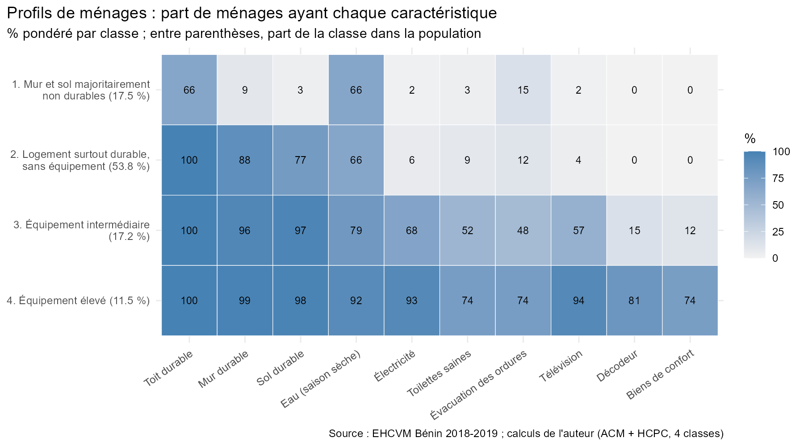

# Profils de ménages au Bénin selon le logement et les équipements (EHCVM 2018-2019)

## Question

Quels profils de ménages se dégagent au Bénin selon la qualité du logement, l'accès aux services et les équipements, et ces profils correspondent-ils à des niveaux de dépense par tête différents ? L'analyse est descriptive : elle regroupe des ménages qui se ressemblent, sans expliquer les écarts.

## Données

- **Source** : enquête harmonisée sur les conditions de vie des ménages (EHCVM) du Bénin, 2018-2019, Banque mondiale, Microdata Library (identifiant `BEN_2018_EHCVM_v02_M`) : https://microdata.worldbank.org/catalog/4291/get-microdata
- **Licence** : données soumises aux conditions d'utilisation de la Microdata Library (Banque mondiale) : usage de recherche statistique et scientifique, pas de redistribution sans accord écrit préalable, diffusion d'informations agrégées uniquement, aucune tentative d'identification des répondants.
- **Citation** (selon les exigences de la page de l'enquête) : WAEMU Commission, *Harmonized Survey on Households Living Standards, Benin 2018/19*. Ref. BEN_2018_EHCVM_v02_M. Dataset downloaded from www.microdata.worldbank.org on 20 November 2026. Investigateur principal : Institut National de la Statistique et de l'Analyse Économique (INSAE). DOI : https://doi.org/10.48529/rn3k-z374
- Les données brutes **ne sont pas incluses** dans ce dépôt, ni aucun fichier au niveau des ménages : seuls des résultats agrégés sont publiés. Les fichiers se téléchargent sur le lien ci-dessus (accès après inscription gratuite et acceptation des conditions d'utilisation).
- **Variable de bien-être** : `pcexp` (« indicateur de bien-être » du fichier bien-être), consommation annuelle par personne en FCFA, corrigée des écarts de prix (la base fournit un déflateur spatial et un déflateur temporel ; contrôle dans la section 3 du script).

## Méthode

R 4.6.1 (tidyverse, haven, FactoMineR, factoextra, mclust). Analyse des correspondances multiples (ACM) pondérée sur 10 variables de logement, de services et d'équipements, puis classification hiérarchique ascendante (HCPC) sur les deux premiers axes, en 4 classes. La dépense par tête n'entre pas dans la construction des classes : elle sert de validation externe. Tests de robustesse : sans pondération, 3 et 5 classes.

## Résultats principaux

- Quatre profils de ménages, du logement surtout non durable à l'équipement élevé. Le plus répandu (**53,8 %** des ménages) vit dans un logement surtout durable, mais sans équipement (électricité : 6,5 %).
- La dépense annuelle médiane (pondérée) par tête augmente d'un profil à l'autre, de **241 354 à 657 993 FCFA par an et par tête**, soit environ **2,7 fois** plus (médiane de l'ensemble : 331 361 FCFA). Cela décrit des regroupements et n'établit aucune causalité.
- Les profils des extrémités sont stables à la pondération et au nombre de classes ; les profils intermédiaires dépendent du nombre de classes choisi.



Rapport complet : [`report/rapport_profils_menages_benin.pdf`](report/rapport_profils_menages_benin.pdf)

## Limites

- Enquête à un moment donné (2018-2019) : pas d'évolution dans le temps, pas de causes.
- Cinq biens rares (fer, réfrigérateur, cuisinière, ordinateur, voiture) regroupés en une variable ; le seuil de 5 % est empirique.
- Le nombre de classes (4) est un choix ; le profil 2 est large et hétérogène, le profil 3 est un profil de transition.

## Reproduire l'analyse

1. Télécharger les fichiers `ehcvm_menage_ben2018.dta` et `ehcvm_welfare_ben2018.dta` dans `data/raw/`.
2. Installer les packages : `install.packages(c("tidyverse", "haven", "FactoMineR", "factoextra", "mclust"))`.
3. Ouvrir le projet RStudio (le répertoire de travail doit être la racine du projet) et exécuter `scripts/analyse_menages.R`. Les tableaux et figures sont écrits dans `outputs/`.

## Structure du dépôt

```
scripts/analyse_menages.R   # analyse complète, par sections numérotées
outputs/tables/             # tableaux (profils, contributions, descriptif)
outputs/figures/            # figures
report/                     # rapport PDF
data/SOURCE.txt             # source et date de téléchargement des données
```

## Auteur

Sètondji Venud Tamegnon · [LinkedIn](https://www.linkedin.com/in/venud-tamegnon-61b8183b2/)
